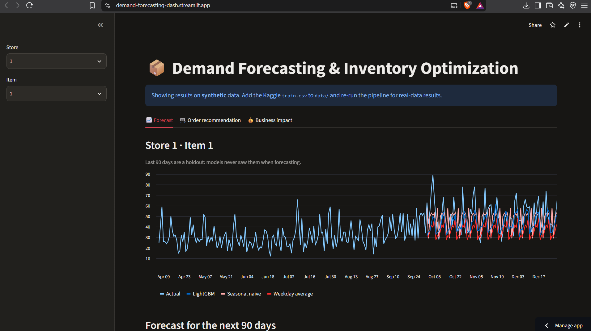

# 📦 Demand Forecasting & Inventory Optimization

An end-to-end system that **forecasts daily product demand** for every store-item pair and turns the
forecast into a **concrete purchasing decision** ("order 608 units now") using safety-stock theory,
then **replays history to measure the business impact** of those decisions.



Forecasting is only useful if it changes what a business *does*. This project covers the whole chain:
data → features → models → inventory policy → business simulation → dashboard + REST API.

> **Live demo:** [demand-forecasting-dash.streamlit.app](https://demand-forecasting-dash.streamlit.app)  ·  **Tech:** Python, pandas, NumPy, SciPy, LightGBM, Streamlit, FastAPI, pytest

---

## The business problem
Retailers lose money in two ways: **stockouts** (lost sales) and **overstock** (cash tied up in inventory
and holding costs). Many small businesses plan stock with a simple moving average. This project tests
whether a forecasting model + statistical safety stock does better.

## What's inside
| Step | What it does | Where |
|---|---|---|
| Data | Kaggle *Store Item Demand Forecasting* (10 stores × 50 items × 5 yrs ≈ 913K rows). If the file is missing, a synthetic dataset with the same schema is generated so the project runs immediately. | `src/data.py` |
| Features | Calendar + lag + rolling features. **All lags ≥ 91 days** for a 90-day horizon, so no future information leaks into training. | `src/features.py` |
| Models | Seasonal-naive baseline, weekday-average baseline, and one global **LightGBM** model for all 500 series. | `src/models.py` |
| Inventory | Safety stock `z·σ·√P`, order-up-to level, EOQ, and the order recommendation. | `src/inventory.py` |
| Simulation | Day-by-day replay of the last 90 days under two planning methods. | `src/simulate.py` |
| Serving | Streamlit dashboard and FastAPI service. | `app/`, `api/` |
| Tests | 7 unit tests (leakage guard, EOQ formula, safety stock, order logic, baselines, simulation). | `tests/` |

## Results (synthetic data, 500 series, last 90 days held out)

**Forecast accuracy** (lower is better; WAPE = total absolute error / total sales)

| Model | RMSE | MAE | MAPE % | WAPE % | WAPE improvement vs naive |
|---|---|---|---|---|---|
| Seasonal naive (last week) | 13.56 | 10.17 | 38.4 | 31.99 | – |
| Weekday average (8 wks) | 11.65 | 8.77 | 33.9 | 27.57 | 13.8% |
| **LightGBM** | **9.74** | **7.18** | **26.8** | **22.59** | **29.4%** |

**Inventory simulation** (weekly review, 7-day lead time; baseline = trailing-28-day mean + std)

| Target service level | Fill rate: baseline → forecast | Avg inventory: baseline → forecast | Total cost change |
|---|---|---|---|
| 90% | 99.52% → 99.07% | 95.4K → 84.7K units (−11.2%) | +6.6% |
| 95% | 99.72% → 99.37% | 102.0K → 90.3K units (−11.5%) | +4.2% |
| 98% | 99.86% → 99.60% | 109.5K → 96.6K units (−11.8%) | +1.6% |
| 99% | 99.91% → 99.71% | 114.5K → 100.9K units (−11.9%) | −0.2% |

### Honest reading of these results
- The forecasting gain is **clear**: LightGBM cuts error by ~29% vs the naive baseline.
- The **inventory gain is modest.** The forecast-driven policy holds ~11% less stock but also loses a bit more
  sales at the same *target*, so total cost is about break-even (better only at 99%). Comparing at *equal fill rate*
  (forecast @ 99% vs baseline @ 95%: both ≈ 99.7%) the forecast policy needs only ~1% less inventory.
- **Why:** the safety stock is slightly under-calibrated (forecast errors on the holdout are a bit larger than on the
  validation window), so the policy under-protects. Better calibration (quantile regression or conformal prediction)
  is the obvious next step.
- These numbers come from **synthetic data**. Re-run on the real Kaggle file and update this section with your own numbers.

## Key design decisions
1. **Direct multi-step forecasting with leakage guard** – every lag/rolling feature is shifted ≥ horizon+1 days, so predicting
   day 90 never needs data from day 89. A unit test enforces this.
2. **Safety stock from measured error, not demand variance** – σ is the std of forecast error on a validation window,
   measured on *P-day sums* (not single days) because errors on neighbouring days are correlated, and `σ·√P` on daily errors
   would understate risk.
3. **Weekly-review order-up-to policy** – an earlier version used an (s, S) policy with EOQ batches; large batches
   dominated the stock level and made fill rate ~99.9% regardless of forecast quality, so it could not measure the
   forecast's value. EOQ is still reported as a reference.
4. **Compare at several service levels** – a single service level can hide that one policy simply holds more or less stock.

## Quick start
```bash
git clone https://github.com/shubham-builds-1/demand-forecasting-inventory-optimization.git
cd demand-forecasting-inventory-optimization
python -m venv .venv && source .venv/bin/activate      # Windows: .venv\Scripts\activate
pip install -r requirements.txt

python -m src.pipeline            # ~2 min; add --quick for a 10-second smoke test
streamlit run app/dashboard.py    # dashboard
uvicorn api.main:app --reload     # API docs at http://127.0.0.1:8000/docs
pytest                            # unit tests
```

**Use the real dataset:** download `train.csv` from the Kaggle competition *Store Item Demand Forecasting Challenge*,
place it at `data/train.csv` (columns: `date, store, item, sales`) and re-run `python -m src.pipeline`.

### API examples
```
GET /forecast/1/1                                  -> next 90 days of demand
GET /recommend?store=1&item=1&on_hand=100          -> {"order_qty": 608, "action": "ORDER 608 units now", ...}
```

## Project structure
```
├── src/          config, data, features, models, inventory, simulate, pipeline
├── app/          Streamlit dashboard
├── api/          FastAPI service
├── tests/        unit tests
├── artifacts/    pipeline outputs (forecasts, plan, metrics) read by the app
└── data/         put Kaggle train.csv here
```

## Assumptions & limitations
- The dataset has **no prices or costs**. Unit cost (5–60), 20% yearly holding rate, $50 order cost, 40% margin on lost
  sales and a 7-day lead time are **assumed** (`src/config.py`). Business-cost numbers are only as good as these inputs.
- Lost-sales model, deterministic lead time, independent items (no shared warehouse capacity or supplier constraints).
- Single train/validation/holdout split rather than rolling-origin backtesting.

## Ideas to extend
Quantile / conformal prediction for better safety stock · rolling-origin backtesting · hierarchical forecasting ·
promotions and price features · stochastic lead times · Docker + CI.
